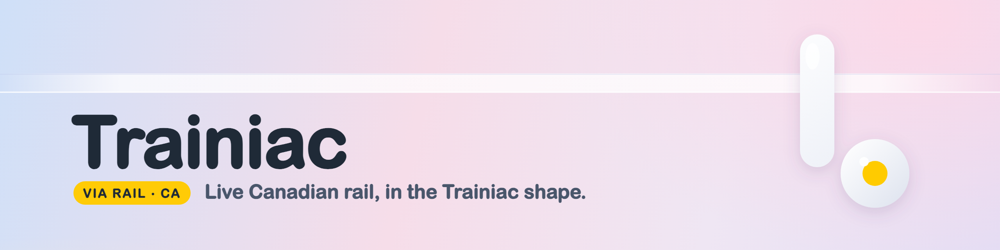

<p align="center">
  
</p>

Live **VIA Rail (Canada)** data, as typed JSON, in the exact shape of the
[Trainiac `/v1` API](https://github.com/trainiac-hq/docs). Ask for a station's
departures, plan a journey, find where a train is right now, or see today's
delays — the same endpoints, the same envelope, the same `v1.d.ts` types you
already use for the UK, pointed at Canadian passenger rail.

It is a **new coverage area**, not a change to the existing Trainiac codebase:
a standalone, dependency-free service that speaks the published contract, built
from VIA's own open feeds. Everything is a `GET`, CORS is open, and there is no
key.

```sh
node src/server.ts
curl 'http://localhost:8787/v1/departures/Toronto?limit=5'      # next trains from Toronto
curl 'http://localhost:8787/v1/journey/Toronto/Montr%C3%A9al'   # Toronto to Montréal
curl 'http://localhost:8787/v1/train?headcode=1'                # where is the Canadian?
```

## Why it is shaped this way

The Trainiac backend is private; what's public is the **contract** (`docs`:
`v1.d.ts` + `openapi.v1.json`). So this adapter targets that contract exactly.
It imports the published types, serves all ten `/v1` endpoints, and a strict
validator checks every response against `openapi.v1.json` in the test suite —
so a VIA answer is indistinguishable in shape from a UK one. That is precisely
the surface a new region would expose inside Trainiac's architecture.

## What you can ask

Base URL defaults to `http://localhost:8787`. `GET /v1` lists everything.

| Ask for | Endpoint |
| --- | --- |
| The departure board at a station | `/v1/departures/{station}` |
| Trains from A to B, with changes | `/v1/journey/{from}/{to}` |
| Where one train is right now | `/v1/train?headcode=…` |
| A station's code from its name | `/v1/stations?q=…` |
| What actually ran at a station in the last 3 hours | `/v1/stations/{station}/activity` |
| The worst delays right now | `/v1/delays` |
| Today's cancellations | `/v1/cancellations` |
| Today's headline numbers | `/v1/summary` |
| Whether the data is fresh | `/v1/status` |

Everything the UK contract documents holds here: one `Answer<Request, Data>`
envelope, a `type` on every value that can be one of several things, every key
always present (`null` means "doesn't exist", states like `no_information` are
their own `type`), and times are ISO 8601 **with each station's own offset** —
VIA spans six time zones, so a Vancouver call reads `-08:00` and a Halifax one
`-04:00`.

Stations can be written as a **code** (`TRTO`, `MTRL`, `VCVR`), a **name** in
any word order (`toronto`, `Sudbury Jct`), or a **group** (a city that has more
than one station). Answers always use proper names (`Montréal`, not `MONTRÉAL`).

## How VIA maps onto the contract

The contract was written for UK rail, so a few fields carry the nearest VIA
equivalent. Everything VIA genuinely can't supply uses the contract's honest
"we don't know" member rather than a guess.

| Contract field | VIA source |
| --- | --- |
| `Station.crs` | VIA's four-letter station code (`TRTO`, `VCVR`) |
| `Train.headcode` | the VIA train number (`1`, `52`, `693`) |
| `Train.uid` | the GTFS ticketing id (`VIA1`) |
| `Train.id` | `<number>:<run-date>`, set once the train is live (like TRUST activation) |
| `Operator` | always `{ "code": "VIA", "name": "VIA Rail" }` |
| `service_class` | always `passenger` |
| `Estimate.forecast.source` | `live_report` — VIA's GPS-based projection |
| `delay_reason`, cancellation `reason.description` | VIA's plain-English service alert |
| `StationMatch.tiploc` | the VIA station code (the key for VIA's other open data) |

Where the data comes from:

- **Live tracker** — `tsimobile.viarail.ca/data/allData.json`: every train in a
  current window, with GPS position and a full stop list of scheduled and live
  times. Powers actuals, forecasts, positions, delays and activity.
- **GTFS schedule** — `viarail.ca/.../viarail.zip`: the authoritative 387-station
  registry and the forward timetable. Powers upcoming departures, journey
  planning and today's counts. Multi-day trains (the Canadian runs four days)
  and all six time zones are materialised correctly — the maths is verified
  against the live feed to the minute (see `test/units.test.ts`).

Live data wins over the schedule for the same train on the same day; when the
tracker is silent the schedule still answers, so the board never goes dark.

## Known divergences

Honest notes on where VIA and the UK-shaped contract don't line up one-to-one:

1. **`status.feeds` keys.** The contract fixes them to `{ trust, td, darwin }`,
   which are Network Rail / National Rail feed names. To stay type-compatible,
   the VIA live tracker is reported under `trust` (it is the movement feed) and
   `td`/`darwin` are `{ type: "unknown" }`. A VIA-native contract would rename
   these. This is the one place the contract itself is UK-shaped.
2. **Platforms.** No VIA feed carries platform/track, so every `platform` is
   honestly `{ type: "unknown" }`.
3. **`stanox` / `coaches` / `formation_changes` / `formed_from`.** No VIA
   equivalent: `null` or empty, as the contract allows.
4. **Journeys** are planned over VIA's (sparse, corridor-shaped) network up to
   two changes, which covers every realistic VIA itinerary.
5. **Cancellations** come from service alerts rather than a structured feed, so
   `reason.code` is `"VIA"` and `reason.category` is `"VIA service alert"`.

## Running it

Node 22+ (it runs the TypeScript directly — no build step).

```sh
node src/server.ts            # live data from VIA, on :8787
PORT=9000 node src/server.ts

npm run demo                  # sample of every endpoint, offline from fixtures
npm run demo -- --live        # …against live VIA feeds
npm test                      # 33 tests incl. strict openapi.v1.json validation
npm run typecheck             # tsc --noEmit
```

Use it from code exactly as the UK docs show — copy `src/v1.d.ts` (the published
contract, vendored unchanged) and `fetch` the endpoints.

## Terms and data

For **personal, non-commercial** use, matching the Trainiac terms. The data
underneath is **© VIA Rail Canada**, published under the
[Open Government Licence – Canada 2.0](https://open.canada.ca/en/open-government-licence-canada);
building something commercial means going to VIA's
[developer resources](https://www.viarail.ca/en/developer-resources) directly.
Nothing here is smoothed or invented — times are what VIA's feeds said. Don't
rely on it for anything safety-critical.
